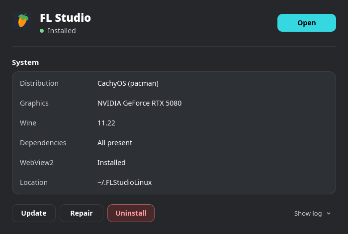

# FL Studio Linux



One-click installer and launcher for FL Studio on Linux. It creates a private
Wine prefix, installs the official Windows build from Image-Line, adds the
fonts and plugin runtimes FL Studio expects, applies the WebView2 workarounds
and creates a menu entry that always launches the right environment.

## Features

- Private Wine 11.22 WoW64 build (Kron4ek) with Wine 11.21 as a fallback, so
  no 32-bit host libraries are needed. FL Studio 26.1.4 and later need Wine
  11.21 or newer for the signature check.
- System dependencies for Arch, Ubuntu-family, Fedora and openSUSE
- Microsoft core fonts (Arial, Verdana and the rest) plus MS Gothic for
  musical symbols, so FLEX, FL Cloud and the Sounds tab render correctly
- Visual C++, GDI+ and shader compiler runtimes for Windows plugins
- DXVK on by default, with Vulkan rendering and WebView2 GPU acceleration
- Bundled WinePipe ASIO driver, installed and selected automatically
- PipeWire's failing virtual MIDI inputs disabled in FL Studio
- WebView2 runtime fallback, registry fixes, disabled Edge updater
- Automatic Wine DPI from the display's resolution and scale
- FLP association and `flstudio://` sign-in handler
- Update, repair and uninstall, live log and visible errors
- Every action supports `--dry-run`

## Install

Packages are attached to each [release](https://github.com/360900/FL-Studio-Linux/releases).

Arch and derivatives:

```sh
git clone https://github.com/360900/FL-Studio-Linux
cd FL-Studio-Linux/packaging/arch && makepkg -si
```

Debian, Ubuntu and derivatives:

```sh
sudo apt install ./fl-studio-linux_<version>-1_amd64.deb
```

Fedora:

```sh
sudo dnf install ./fl-studio-linux-<version>-1.x86_64.rpm
```

openSUSE:

```sh
sudo zypper install ./fl-studio-linux-<version>-1.x86_64.rpm
```

Any distro, AppImage (no arguments opens the GUI, arguments go to the CLI):

```sh
chmod +x FL_Studio_Linux-<version>-x86_64.AppImage
./FL_Studio_Linux-<version>-x86_64.AppImage
./FL_Studio_Linux-<version>-x86_64.AppImage install --dry-run
```

Other distros, from the release tarball (or after `make build`):

```sh
sudo make install            # PREFIX=/usr/local by default
sudo make uninstall
```

## Build

Requires Rust 1.88+.

```sh
make build                   # cargo build --release --locked --workspace
```

Building the GUI needs fontconfig headers (`libfontconfig1-dev`,
`fontconfig-devel`).

## Usage

GUI:

```sh
fl-studio-linux-gui                          # installed
cargo run --release -p fl-studio-linux-gui   # from a source checkout
```

CLI:

```sh
fl-studio-linux install     # --installer <setup.exe>, --dxvk true|false, --fonts true|false, --audio winepipe|none, --dpi <n>
fl-studio-linux launch      # project.flp or flstudio://... args are forwarded
fl-studio-linux update
fl-studio-linux repair      # missing fonts, prefix settings, DXVK, audio driver, launcher
fl-studio-linux uninstall
```

`--dpi` takes 96 to 480 (96 = 100%) and defaults to the display's DPI. Add
`--dry-run` to preview changes and `--yes` to skip prompts. Hidden
diagnostics: `doctor`, `deps`, `wine-setup`.

## Notes

- FL Studio 26.1.4 and later need Wine 11.21 or newer. Do not switch the
  prefix to an older runner.
- Install, update and repair refuse to run while FL Studio is open from the
  prefix, since they restart its Wine server. Save and close FL Studio first.
- FL Studio always starts through the prefix's private Wine build. Launching
  the EXE directly would let the system Wine handle it and break WebView2 and
  DXVK isolation.
- DXVK is on by default and maps Direct3D to Vulkan. It installs DXVK 3.1.1
  on Vulkan 1.4 drivers, 2.7.1 on Vulkan 1.3 drivers, and is skipped on older
  ones. If a plugin or the WebView2 panes misbehave, run
  `fl-studio-linux repair --dxvk false`.
- WinePipe is the low-latency driver and talks to PipeWire directly. It is
  installed and selected in FL Studio automatically. Change it with `--audio`
  or in `Options > Audio settings` in FL Studio.
- FL Studio disables PipeWire's internal `PipeWire-System`,
  `PipeWire-RT-Event` and `Midi Through` inputs during install. If no hardware
  MIDI controller is connected, MIDI input is also turned off so FL does not
  raise the PipeWire driver error at startup. Connect a controller and run
  Repair to enable MIDI input again. With hardware present, the virtual ports
  stay disabled but their `FAIL` labels can remain in the MIDI list.
- FL Cloud, the Help pane and the Sounds tab are WebView2 pages. They need the
  Microsoft fonts and plugin runtimes installed by this app. If Image-Line's
  installer skips WebView2, the app downloads and installs Microsoft's
  Evergreen runtime itself; a bare FL Studio install in Wine leaves them black.
- The installer starts Edge WebView2 near the end and can look stuck while its
  services keep running. The watchdog stops the prefix after FL64.exe has been
  stable for a while.
- 32-bit plugins are fragile under Wine. Prefer the 64-bit versions.
- On immutable distributions such as Bazzite, install `winetricks`,
  `cabextract` and the Wine libraries with `rpm-ostree` first. The installer
  warns and continues when no package plan exists, but fonts need winetricks.
- Run the installer as your normal user. It asks for elevation only when it
  installs system packages; running the whole app with `sudo` would create the
  prefix and menu entries in root's home.

## Files

- Config: `~/.config/fl-studio-linux/config.toml` (respects `XDG_CONFIG_HOME`)
- Wine prefix: `~/.FLStudioLinux` (override with `--prefix`)
- Logs: `<prefix>/logs` and `~/.cache/fl-studio-linux/launch.log`
- Download cache: `~/.cache/fl-studio-linux` (respects `XDG_CACHE_HOME`)

## Layout

| Path | Purpose |
| --- | --- |
| `crates/core` | Headless engine |
| `crates/cli` | `fl-studio-linux` CLI, used by the desktop entry |
| `crates/app` | Slint GUI |
| `ui/main.slint` | Window layout |
| `packaging` | Desktop entry, icon, PKGBUILD, AppImage |
| `vendor` | Bundled WinePipe binaries and license |

## Credits

- [Torbuntu/fl-studio-linux-setup](https://github.com/Torbuntu/fl-studio-linux-setup)
  for the Bottles setup notes, font requirements and WebView2 findings
- [FL Studio 2026 on Linux](https://pr1v8.ca/posts/fl-studio-wine-plugins-ilok/)
  for the WebView2 Windows 8 workaround and plugin runtimes
- [FL Studio on Linux in 2026](https://blog.mrquantumoff.dev/fl-studio-on-linux-in-2026-is-very-much-usable-with-vsts-too-with-wine/)
  for the font, runtime and NVIDIA vsync notes
- [mrquantumoff/winepipe](https://github.com/mrquantumoff/winepipe) for the
  direct PipeWire ASIO driver
- [Kron4ek/Wine-Builds](https://github.com/Kron4ek/Wine-Builds) for the Wine builds
- WineHQ bug 60273 and the Wine 11.21 release for the FL Studio signature fix

## License

GPL-3.0-or-later. See [LICENSE](LICENSE). The bundled audio driver keeps its
own licenses; see [THIRD_PARTY_NOTICES.md](THIRD_PARTY_NOTICES.md).
